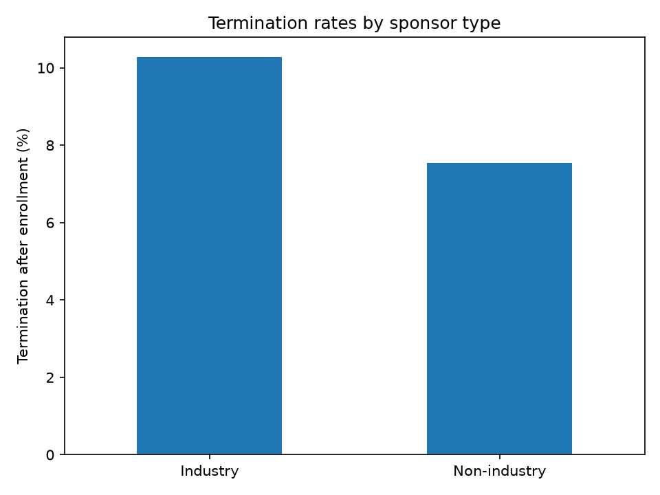
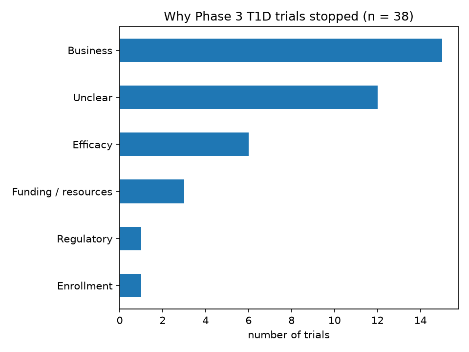

# Why Do Phase 3 Type 1 Diabetes Trials Stop?

An analysis of 355 Phase 3 type 1 diabetes (T1D) trials from ClinicalTrials.gov: how often trials stop early, and why.

## Data

- Source: ClinicalTrials.gov API v2, snapshot pulled 2026-10-24.
- 419 trials returned by the search; 356 after the relevance filter; 1 excluded by manual review → **355 trials analyzed**.
- Status breakdown: 264 completed, 27 terminated, 19 recruiting, 18 unknown, 11 withdrawn, 10 active (not recruiting), 6 not yet recruiting.
- 35 trials are still running, and 18 (5.1%) have unknown status.

## Findings

### Industry vs. non-industry sponsors

| Sponsor | Terminated after enrollment | Didn't finish as planned |
|---|---|---|
| Industry (203 trials) | 10.3% (19 of 185) | 13.1% (25 of 191) |
| Non-industry (152 trials) | 7.5% (8 of 106) | 11.7% (13 of 111) |

- Industry trials terminated somewhat more often, but the difference is small relative to the sample sizes.
- Every business-driven stop was industry-sponsored. Most non-industry stops gave no clear reason.
- The higher industry rate appears to reflect commercial decisions rather than more frequent treatment failure.

### Termination rates

| Metric | Known outcomes | Range with unknowns |
|---|---|---|
| Terminated after enrollment | 9.3% (27 of 291) | 8.7% – 14.6% |
| Didn't finish as planned (terminated + withdrawn) | 12.6% (38 of 302) | 11.9% – 17.5% |

About 1 in 11 trials that enrolled patients was stopped early. Including trials withdrawn before enrollment, about 1 in 8 did not finish as planned.

### Why trials stopped (n = 38)

| Reason | Trials | Share |
|---|---|---|
| Business / commercial | 15 | 39.5% |
| Unclear / not stated | 12 | 31.6% |
| Efficacy / futility | 6 | 15.8% |
| Funding / resources | 3 | 7.9% |
| Regulatory | 1 | 2.6% |
| Enrollment | 1 | 2.6% |
| Safety | 0 | 0.0% |

- Business decisions were the most common reason, more than twice as common as efficacy or futility.
- No trial stopped for a stated safety reason.
- Nearly a third of stopped trials gave no usable reason (e.g., "Administrative" or blank), which limits what registry data can explain.

### Inhaled insulin

- 28 trials tested inhaled insulin; **15 (54%) were stopped**, accounting for **39% of all stopped trials**.
- Most cited commercial decisions: Pfizer's withdrawal of Exubera (2007–08) and Novo Nordisk ending AERx development.
- Four academic Exubera trials list only "Administrative" as the reason and were likely affected by the product's withdrawal.
- MannKind's inhaled insulin (Afrezza) was eventually approved, so this reflects specific commercial decisions rather than the treatment approach failing.

## Methods

- **Data pull:** `query.cond = type 1 diabetes`, `filter.advanced = AREA[Phase]PHASE3`, paginated (100 per page) and saved as a dated JSON snapshot. Each new pull creates a new dated file.
- **Flattening:** each trial reduced to one row with 14 fields (status, why stopped, sponsor, dates, enrollment, phases, conditions, results posted, brief summary, detailed description). Missing fields kept as blank rather than dropped.
- **Relevance filter:** the condition search also returned unrelated and T2D-only trials. A trial was kept if its conditions mention diabetes (including generic "Diabetes" and diabetic complications) and it is not Type 2–only. Trials mentioning both Type 1 and Type 2 were kept. 63 of 419 trials were excluded.
- **Manual exclusion:** 1 trial (NCT00521820) excluded; its summary describes a Type 2 population, but its only condition label is the generic "Diabetes Mellitus."
- **Phase 2/3 trials:** kept, since they include a Phase 3 component.
- **Termination metrics:** Metric 1 excludes withdrawn trials, which never enrolled patients. Metric 2 counts terminated + withdrawn. Both use only trials with a known outcome as the denominator.
- **Unknown status:** outcomes cannot be determined, so results are reported as a range (all unknowns completed vs. all failed).
- **Stop-reason categorization:** the 38 terminated or withdrawn trials were hand-coded into 7 categories using a written labeling guide (`labeling_guide.md`; labels in `data/labels/stop_reasons_gold.csv`). Where `why_stopped` referred to the detailed description, that text was used.
- **Inhaled-insulin identification:** brief summaries and detailed descriptions were searched for "inhal" and product names (Exubera, AERx, Technosphere, Afrezza).

## Limitations

- Trials mentioning both Type 1 and Type 2 were kept, so some results include T2D patients.
- Generic diabetes and complication trials were kept and may include T2D patients.
- The API's condition search matches keywords beyond the conditions field, returning unrelated trials (e.g., melanoma immunotherapy). Relevance was determined by text-matching, which may misclassify some trials.
- Unknown-status trials were last updated a median of ~2 years earlier than completed trials, consistent with abandoned records; their true outcomes are unknown.
- Small sample: 38 stopped trials, so category percentages are sensitive to individual trials.
- Stop reasons were coded by a single reviewer.
- Inhaled-insulin terminations are not independent: a few corporate decisions stopped many trials at once.
- Results reflect a single snapshot (2026-10-24); the registry changes daily.

## Future work

- Results posting: what share of completed trials posted results, by sponsor type.
- Trends over time: trial starts and termination rates by decade.
- Enrollment: trial size for completed vs. terminated trials.
- Automate stop-reason classification (keyword rules or an LLM with human review) and validate it against the hand-coded labels, to support a larger dataset covering all trial phases.

## Project structure

- `01_pull.ipynb`: pulls trials from the ClinicalTrials.gov API and saves a dated raw JSON snapshot.
- `02_flatten.ipynb`: flattens trials into a table, applies the relevance filter and exclusions, saves the processed CSV.
- `03_analysis.ipynb`: calculates termination rates, stop-reason breakdowns, and the inhaled-insulin analysis.
- `data/raw/`: raw JSON snapshots.
- `labeling_guide.md`: definitions and rules for categorizing stop reasons.
- `data/labels/`: hand-coded stop reasons.